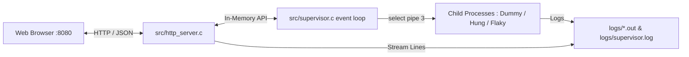

# Linux Service & Process Supervisor — Web Console

A responsive, high-performance HTML5/CSS3/JavaScript web console directly connected to the embedded non-blocking HTTP REST server inside the Linux Service & Process Supervisor written in C11.

---

## 1. Architectural Integration

The C supervisor (`bin/supervisor`) embeds a lightweight, non-blocking HTTP/1.1 server (`src/http_server.c`) integrated directly into its POSIX `select()` event multiplexing loop on port **8080**:



1. **Embedded Web Server**:
   - Zero external web servers (Nginx/Apache/Node) required for production runtime.
   - Serves static assets (`index.html`, `styles.css`, `app.js`) directly from C using socket `write()`.
   - Sends cache-invalidation headers (`Cache-Control: no-cache, no-store, must-revalidate`, `Pragma: no-cache`, `Expires: 0`) so browser reloads always fetch the latest frontend logic.
2. **REST Endpoints**:
   - `GET /api/status`: Real-time state of all registered services, kernel PIDs, PGIDs, uptimes, restart and crash counters, memory (`rss_kb`), and live heartbeat pulse timers.
   - `POST /api/action`: Sends POSIX signals (`SIGTERM`, `SIGKILL`, `SIGSTOP`, `SIGCONT`) or triggers `fork()`/`execvp()` restarts and batch operations (`start_all`, `stop_all`, `approve_waiting`, `reload`, `shutdown`). `stop_all` safely stops all child worker processes while keeping the HTTP supervisor server online.
   - `GET /api/logs?service=<name>&lines=<n>`: Streams live log lines from `logs/supervisor.log` or worker output files (`logs/<name>.out`).
   - `GET /api/config` & `POST /api/config`: Reads and updates `config/services.conf` with instant live reload via `SIGHUP`.
3. **CORS Support**: Any external browser or dev server (`python3 -m http.server 8000`) can communicate seamlessly with the C supervisor backend via CORS headers (`Access-Control-Allow-Origin: *`).

---

## 2. Web Console Features & UI Structure

### 2.1 Live Dashboard (`#page-dashboard`)
- **Metric Cards**: Real-time counts of managed services, active running services, total restarts/crashes, and memory footprint (supervisor RSS vs child max RSS).
- **Service Overview Table**: Condensed status table featuring service name, command, PID, status badge, uptime, live heartbeat indicator, and quick action buttons.
- **Service Action Controls**: `▶ Start All`, `⏹ Stop All` (safely stops all workers without killing the HTTP server), `✔ Start Ready Waiting (y)`, `⟳ Reload Config`, and `✕ Shutdown Backend`.
- **Latest Events Stream**: Live audit trail snippet automatically refreshed from `logs/supervisor.log`.

### 2.2 Process Management & Services Table (`#page-services`)
- **Process Table & Toolbar**:
  - Displays Service Name, Command, PID, PGID, State, Restarts/Crashes, Resident Memory (`rss_kb`), Heartbeat Pulse, and Action Controls.
  - Toolbar features: `Search filter`, `▶ Start All`, `⏹ Stop All`, `🎲 Random Restart`, `⚡ Auto-Chaos (12s)`, `✔ Start Ready Waiting`, and `⟳ Reload Config`.
- **Heartbeat Pulse Column & Indicator**:
  - **Active Pulses**: Animated glowing green dot (`@keyframes hbPulseAnim`) showing `Pulse (1s ago) / 6s max`.
  - **Stalled Pulses**: Warning amber indicator `⚠️ Stalled (Ns)` when watchdog threshold is exceeded.
  - **Disabled / Offline**: Grey badge indicating no IPC watchdog configured or process stopped.
- **Dedicated IPC Heartbeat Telemetry Monitor**:
  - Interactive grid cards for each service displaying PID, anonymous pipe IPC channel status (`pipe(3) IPC`), watchdog timeout threshold, live pulse timer, and a direct **"View log →"** button.
- **Multi-Service Concurrency Enforcement**:
  - Automatically ensures multiple dependent services continue running whenever any service crashes or restarts.
- **Process Signal Controls**:
  - `▶ Start`: Spawns child process via `fork()` + `execvp()`.
  - `⏹ Stop`: Sends `SIGTERM` to the child's process group.
  - `↻ Restart`: Sends `SIGTERM`, waits for termination, and restarts.
  - `⏸ Pause`: Suspends execution via `SIGSTOP`.
  - `⏵ Resume`: Resumes execution via `SIGCONT`.
  - `✕ Kill`: Forces immediate termination via `SIGKILL`.

### 2.3 Logs & Event Streamer (`#page-logs`)
- Dropdown selector supporting:
  - Supervisor Audit Log (`logs/supervisor.log`)
  - `heartbeat` service output (`logs/heartbeat.out`)
  - `logger` service output (`logs/logger.out`)
  - `metrics` service output (`logs/metrics.out`)
  - `audit` service output (`logs/audit.out`)
  - `flaky` service output (`logs/flaky.out`)
  - `hung` service output (`logs/hung.out`)
- **Custom Worker Log Tagging**: Formats and highlights worker lines like `[heartbeat]`, `[metrics]`, `[logger]`, and `[audit]` with distinct colored badges.
- **Real-Time Log Controls**: Search filter, Pause streaming button, Clear view button, and Manual refresh button.

### 2.4 Configuration Editor (`#page-configuration`)
- In-browser code editor for `config/services.conf`.
- Save & Apply triggers `POST /api/config`, immediately signaling `SIGHUP` to the C supervisor to hot-reload services without process downtime.

### 2.5 Resources & Architecture Views
- **Kernel Resource Telemetry**: CPU user time, system time, load averages (`1m`, `5m`, `15m`), and max RSS memory from `getrusage()`.
- **Architecture Diagrams**: Visual guide explaining `fork()`, `execvp()`, `setsid()`, `waitpid()`, `pipe()`, and `select()`.

---

## 3. How to Run

### Method 1: Local Development with Auto-Browser & Auto-Recovery (`npm run dev`)
From the project root:

```bash
npm run dev
# or
npm start
```

This launches [`dev.js`](../dev.js), which:
1. Checks if the C supervisor backend is already running on `http://127.0.0.1:8080/`.
2. If offline, boots Ubuntu WSL and executes `./run.sh` to compile and start the supervisor.
3. Automatically opens `http://localhost:8080/` in your default browser.
4. **Auto-Recovery**: Monitors backend health every 4s and automatically relaunches the supervisor backend if it goes offline.

### Method 2: Running Automated End-to-End Tests
From the project root:

```bash
npm test
# or
npm run test_all.py
```

Runs all 9 automated test suites (REST endpoints, chaos restart, `SIGSTOP`/`SIGCONT`, `SIGTERM` stop/start, config & log APIs, 15s concurrency observation, and `/proc` kernel process tree verification).

### Method 3: Native WSL / Linux Run
From the project root:

```bash
chmod +x run.sh
./run.sh
```

Then visit **http://localhost:8080/** in any browser.

### Method 4: Standalone Frontend Server (Optional)
If the C supervisor is already running in the background:

```bash
cd linux-supervisor-website
python3 -m http.server 8000
```

Open `http://localhost:8000/`. The frontend automatically polls `http://localhost:8080/api/status` via CORS.
