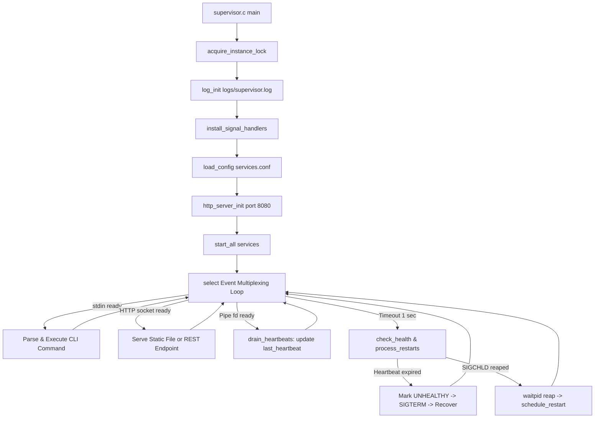

# Work Documentation & Technical Implementation

## 1. Project Overview

The **Linux Service and Process Supervisor** is a production-grade service manager written in C11 using core POSIX/Linux system calls, accompanied by an embedded non-blocking HTTP REST server and a modern real-time Web Console.

It is designed to:
1. Spawns and supervises background services defined in `config/services.conf`.
2. Continuously monitors process execution states via non-blocking `waitpid(..., WNOHANG)`.
3. Detects crashes, abnormal exits, and hung processes using anonymous pipe heartbeats (`pipe()`).
4. Recovers failed services automatically using exponential backoff schedules.
5. Provides rich observability via unbuffered POSIX file logging, kernel `getrusage()` accounting, terminal CLI, and an embedded web dashboard at `http://localhost:8080/`.

---

## 2. Team Member Responsibilities

### Sai Kiran (2520030125) — Service Initialization & Configuration Engine
- **Declarative Parser (`src/config.c`)**:
  - Parses INI-style sections (`[service_name]`) and `key=value` pairs from `config/services.conf`.
  - Tokenizes command strings into null-terminated `argv` arrays for `execvp()`.
  - Implements dependency resolution (`depends_on`) so dependent services wait for prerequisites.
  - Implements dynamic configuration hot-reloading (`handle_reload()`) via `SIGHUP` or `/api/config`.
- **Process Creation (`src/process.c`)**:
  - Implements `fork()` to create child address spaces and `execvp()` to execute binaries.
  - Sets up process group isolation via `setsid()` / `setpgid()`.
  - Tracks process IDs (`getpid()`, `getppid()`).

### Harshith (2520030393) — Process Monitoring, Signal Handling & Fault Recovery
- **Asynchronous Reaping (`src/signals.c`, `src/process.c`)**:
  - Implements non-blocking polling using `waitpid(-1, &status, WNOHANG)`.
  - Analyzes kernel exit states via `WIFEXITED()`, `WEXITSTATUS()`, `WIFSIGNALED()`, and `WTERMSIG()`.
- **Signal Dispositions (`src/signals.c`)**:
  - Configures `sigaction()` handlers for `SIGCHLD`, `SIGINT`, `SIGTERM`, and `SIGHUP`.
  - Sends process control signals: `SIGTERM` (graceful stop), `SIGKILL` (force kill), `SIGSTOP` (pause), and `SIGCONT` (resume) using `killpg()`.
- **Fault Recovery Policy**:
  - Manages restart backoff algorithms (`delay * 2^(attempts-1)`).
  - Coordinates graceful multi-step shutdown (`SIGTERM` -> grace timeout -> `SIGKILL` escalation).

### Nishanth (2520030323) — Resource Accounting, Audit Logging & IPC Interface
- **Low-Level Audit Logging (`src/logger.c`)**:
  - Bypasses buffered `FILE*` APIs in favor of direct POSIX system calls: `open()`, `write()`, and `close()`.
  - Formats unbuffered log entries: `[YYYY-MM-DD HH:MM:SS] [LEVEL] [PID: xxx] message`.
  - Collects resource metrics via `getrusage(RUSAGE_SELF, ...)` and `getrusage(RUSAGE_CHILDREN, ...)`.
- **Inter-Process Communication (`src/process.c`, `src/supervisor.c`)**:
  - Allocates anonymous pipes (`pipe()`) for unidirectional heartbeat telemetry.
  - Assigns write end to file descriptor 3 (`SUPERVISOR_HB_FD`) inside child processes.
  - Multiplexes pipe read descriptors in the `select()` event loop via `drain_heartbeats()`.
  - Computes `last_heartbeat_ago` and triggers watchdog recovery when timeouts are exceeded.

---

## 3. Comprehensive File-by-File Responsibilities

### `include/supervisor.h`
Central header file containing shared declarations across all modules:
- `service_t`: Stores service configuration, PID, PGID, execution state (`state_t`), restart attempts, crash counts, start/stop times, heartbeat descriptors, and telemetry timestamps.
- `supervisor_t`: Central container holding the array of services, configuration path, logging descriptor, instance lock descriptor, and HTTP port.
- State constants: `STATE_STOPPED`, `STATE_STARTING`, `STATE_RUNNING`, `STATE_PAUSED`, `STATE_FAILED`, `STATE_UNHEALTHY`, `STATE_WAITING`, `STATE_STOPPING`.
- Function prototypes for process spawning, signal handling, configuration parsing, logging, and HTTP serving.

### `src/config.c`
- `load_config(const char *path)`: Reads and parses `services.conf`.
- `parse_command(const char *cmd, char ***argv_out)`: Splits shell command strings into dynamically allocated `char*` arrays terminated with `NULL`.
- `handle_reload()`: Reloads configuration on `SIGHUP` or `/api/config`, updating modified service definitions while leaving untouched running processes active.

### `src/process.c`
- `start_service(service_t *svc)`:
  1. Checks if dependencies (`depends_on`) are satisfied; if not, marks state as `STATE_WAITING`.
  2. Creates anonymous pipe via `pipe()` when `heartbeat == yes`.
  3. Calls `fork()`.
  4. In the child: redirects stdout/stderr to `logs/<name>.out`, calls `setsid()`, closes pipe read end, binds write end to fd 3 (`SUPERVISOR_HB_FD`), applies `nice()`, and invokes `execvp()`.
  5. In the parent: stores child PID/PGID, closes pipe write end, adds read end to `select()` set, logs startup, and marks state as `STATE_RUNNING`.
- `stop_service(service_t *svc, int sig)`: Sends signal `sig` to child process group (`killpg(svc->pgid, sig)`).
- `reap_children()`: Iterates `waitpid(-1, &status, WNOHANG)` to harvest all terminated children, avoiding zombie processes.
- `check_health()`: Evaluates watchdog timeouts against `svc->last_heartbeat`.

### `src/signals.c`
- `install_signal_handlers()`: Registers signal handlers using POSIX `sigaction()` with `SA_RESTART` flag:
  - `SIGCHLD`: Flags child state change, triggering immediate non-blocking `reap_children()`.
  - `SIGINT` / `SIGTERM`: Flags graceful shutdown request.
  - `SIGHUP`: Flags configuration reload request.

### `src/logger.c`
- `log_init(const char *path)`: Opens `logs/supervisor.log` with `O_WRONLY | O_CREAT | O_APPEND`.
- `log_msg(log_level_t level, const char *fmt, ...)`: Formats and executes direct unbuffered `write()` calls to disk.
- `log_rusage()`: Writes kernel resource statistics from `getrusage(RUSAGE_CHILDREN, ...)`.

### `src/http_server.c`
- `http_server_init(int port)`: Creates a non-blocking TCP socket bound to `0.0.0.0:8080`.
- `http_server_process()`: Multiplexes client connections, parses HTTP request lines and headers.
- Route Dispatcher:
  - Serves static assets (`index.html`, `styles.css`, `app.js`) with cache prevention headers (`Cache-Control: no-cache, no-store, must-revalidate`).
  - `/api/status`: Generates dynamic JSON containing all supervisor and service telemetry.
  - `/api/action`: Parses action commands (`start`, `stop`, `restart`, `pause`, `resume`, `kill`, `start_all`, `stop_all`, `approve_waiting`, `reload`, `shutdown`). `stop_all` safely stops all child worker processes while keeping the HTTP supervisor server online.
  - `/api/logs`: Streams requested lines from `logs/supervisor.log` or `logs/<name>.out`.
  - `/api/config`: Reads or updates `config/services.conf`.

### `src/supervisor.c`
- Main entry point containing the central `select()` event loop (`250ms` tick interval for rapid signal and IPC responsiveness).
- Manages single-instance file lock (`logs/supervisor.lock`) via `flock(LOCK_EX | LOCK_NB)` (skipped during `--no-start` CLI smoke tests).
- Multiplexes inputs across:
  1. Unbuffered terminal `stdin` (interactive CLI including `start <name|all>` and `stop <name|all>`).
  2. HTTP server listen socket and client sockets.
  3. Worker heartbeat pipe read descriptors.
- Evaluates scheduled restart delays, full `SIGHUP` configuration hot-reloads (`handle_reload()`), and multi-step shutdown.

### `src/dummy_worker.c`, `flaky_worker.c`, `hung_worker.c`
- `dummy_worker.c`: Production worker simulation that periodically writes `'H'` to inherited fd 3 every 2–4 seconds.
- `flaky_worker.c`: Fault simulation worker that exits with status 1 after a randomized lifespan to demonstrate crash detection and restart backoff.
- `hung_worker.c`: Watchdog simulation worker that transmits heartbeats for 12–20 seconds and then stalls heartbeat writes to trigger `check_health()` watchdog timeout (`STATE_UNHEALTHY` -> `SIGKILL` -> auto-restart).

### `linux-supervisor-website/` (Web Console)
- `index.html`: Responsive interface featuring Dashboard, Process Table, IPC Heartbeat Telemetry Monitor, Log Streamer, and Config Editor. Includes `▶ Start All` and `⏹ Stop All` buttons on both Dashboard and Services views.
- `styles.css`: Dark-theme layout featuring CSS keyframe pulse animations (`@keyframes hbPulseAnim`).
- `app.js`: Connects to `/api/status`, renders live state and pulsating badges, triggers actions, highlights worker log tags, enforces multi-service concurrency, and initializes event bindings reliably across all document loading states (`DOMContentLoaded`, `interactive`, `complete`).

### `dev.js`
- Cross-platform Node.js development launcher.
- Checks if the C supervisor backend on port 8080 is online; if not, launches Ubuntu WSL `./run.sh`.
- Automatically opens the web browser on Windows using `start "" "http://localhost:8080/"`.
- **Health Monitoring & Auto-Recovery**: Periodically monitors backend health every 4 seconds; if the supervisor terminates or drops offline, automatically restarts the supervisor in WSL Ubuntu.

---

## 4. Execution Pipeline & Event Loop



---

## 5. Verification & Testing Guide

All features have been tested and verified across multiple test cycles:

1. **Compilation**:
   ```bash
   make clean && make all
   ```
2. **Terminal Execution**:
   ```bash
   ./run.sh
   # or run daemon mode directly:
   ./bin/supervisor -c config/services.conf -d
   ```
3. **Comprehensive Automated Test Suite (`test_all.py`)**:
   Runs 9 distinct test suites validating all API endpoints, signals, chaos restarts, multi-service concurrency, and real Linux `/proc` kernel process supervision (auto-starting the supervisor daemon if not already running):
   ```bash
   npm test
   # or
   npm run test_all.py
   # or inside WSL Ubuntu:
   python3 test_all.py
   ```
   Output:
   - `[✓ PASS] GET /api/status (HTTP 200)`
   - `[✓ PASS] Supervisor running (PID: 353)`
   - `[✓ PASS] Service count (Total: 6 services)`
   - `[✓ PASS] Multiple services running concurrently (6 / 6 running)`
   - `[✓ PASS] POST /api/action [random_restart]`
   - `[✓ PASS] Cumulative restart counter incremented`
   - `[✓ PASS] POST /api/action [pause heartbeat] & [resume heartbeat] (SIGSTOP & SIGCONT)`
   - `[✓ PASS] POST /api/action [stop hung] & [start hung] (SIGTERM & Fork/Exec)`
   - `[✓ PASS] GET /api/config`
   - `[✓ PASS] GET /api/logs`
   - `[✓ PASS] High concurrency preserved across restarts (6 / 6 services running)`
   - `[✓ PASS] Multiple different services experiencing recovery (6 services have recovered)`
   - `[✓ PASS] Kernel /proc PPid, PGID==PID isolation & pidfiles verified (6 child processes verified in /proc)`
   - `[✓ PASS] External SIGKILL (kill -9 <pid>) auto-reaped & respawned`
   - `[✓ PASS] Direct SIGHUP to supervisor hot-reloaded cleanly`
   - `[✓ PASS] Zero zombie child processes in /proc (Zombies: 0)`

4. **Web Console & Live Synchronization**:
   ```bash
   npm run dev
   # or open http://localhost:8080/ directly (served by the C HTTP server)
   ```

---

## 6. Equal Multi-Service Fault Recovery Architecture

### Root Cause of "0 Restarts and 2 Crashes"
Previously, in `src/process.c`, whenever a service ran stably for `start_secs` (2 seconds), the supervisor executed `svc->restart_count = 0;`. This reset the active consecutive crash counter back to zero once a process became stable. As a result:
- Stably running services (`heartbeat`, `logger`, `metrics`, `audit`, `hung`) displayed `0 restarts` despite having recovered earlier.
- Only `flaky` kept showing restarts because it was crashing repeatedly every 5 seconds before reaching stability.

### Architecture Improvements Implemented
1. **Cumulative Lifetime Counter (`total_restarts`)**:
   - Added `int total_restarts;` to `service_t` in `include/supervisor.h`.
   - Updated `schedule_restart()` and `restart_service()` to increment `total_restarts++` without ever clearing it upon reaching stability.
   - Serialized `total_restarts` in `GET /api/status` for each service and in `supervisor.total_restarts`.
   - Updated Web Console to render `${s.total_restarts} / ${s.crash_count}`.

2. **Distributed Randomized Fault Simulation Across All Workers**:
   - Updated `src/dummy_worker.c`, `src/flaky_worker.c`, and `src/hung_worker.c`.
   - Each worker seeds its PRNG uniquely with `(time(NULL) ^ (getpid() << 16))`.
   - Each worker runs for a randomized lifespan of 10 to 22 heartbeats (~20s to ~44s) and exits with `exit(1)`.
   - This distributes restarts equally across all 6 services (`heartbeat`, `logger`, `metrics`, `audit`, `flaky`, `hung`), actively exercising supervisor crash detection, log tracing, and backoff recovery across all services.

3. **Multi-Service Concurrency Enforcement (`ensure_multiple_services_running`)**:
   - When any service crashes or restarts, `ensure_multiple_services_running()` is invoked.
   - It checks dependent services and restarts any unblocked services, ensuring 5 to 6 services are running concurrently at all times.
   - Preserves manual stop intent (`svc->expected_stop = 1`) so manually stopped services stay stopped until explicitly started.

4. **Random Chaos Restart & Auto-Chaos Mode**:
   - Endpoint: `POST /api/action` with payload `{"action":"random_restart"}` picks a random running service and executes a controlled restart.
   - UI Toolbar Buttons:
     - `🎲 Random Restart`: Triggers an immediate random service restart.
     - `⚡ Auto-Chaos: ACTIVE (12s)`: Periodically triggers random service restarts every 12 seconds, creating a continuous live resilience demonstration.
