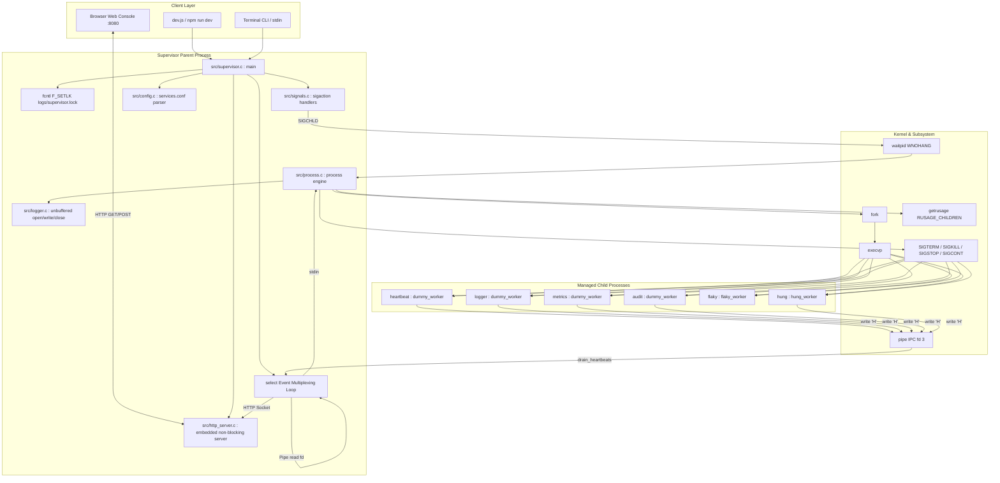
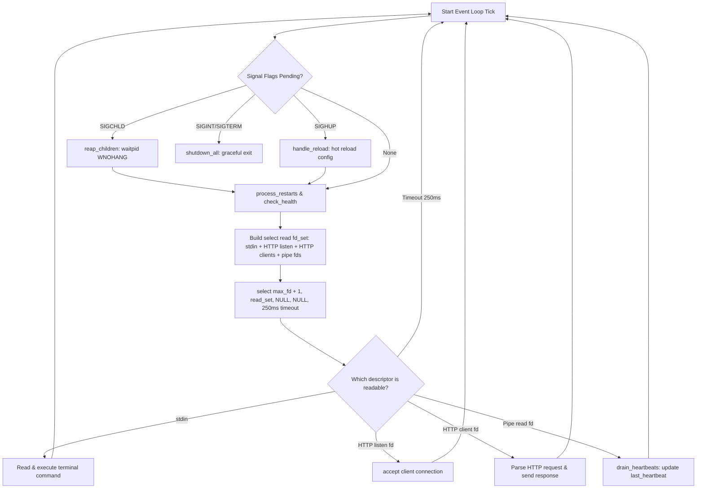
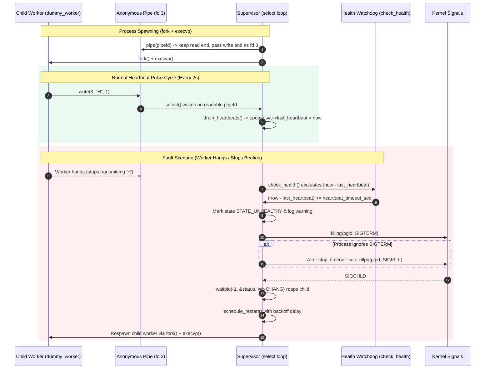
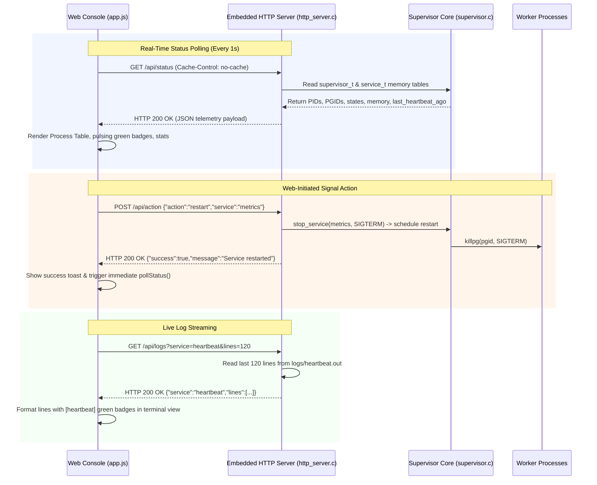
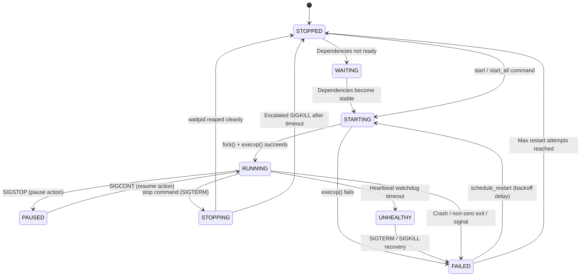
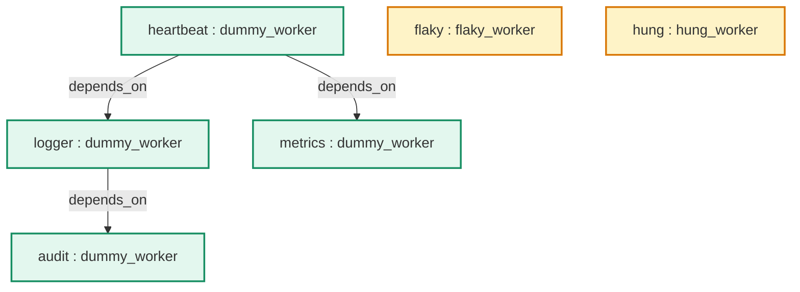

# Project Architecture & Operational Workflow

## 1. Project Information

- **Team:** task killers  
- **Project Title:** Linux Service and Process Supervisor  
- **Course:** Operating Systems  
- **Language:** C11 with POSIX/Linux APIs & Modern Web Console (HTML5/CSS3/JavaScript)  
- **Repository:** https://github.com/slashnight/KLH_CSE_2026-27_Team-22_Service-and-process-supervisor  

---

## 2. End-to-End System Architecture

The supervisor is an OS-level parent process that manages multiple isolated child worker processes while concurrently serving an embedded HTTP REST API and real-time Web Console.

---

## 3. Core Module & File Map

| File | Primary Responsibility | Key Functions & System Calls |
|---|---|---|
| `include/supervisor.h` | Shared structures, state enums, IPC constants, prototypes | `service_t`, `supervisor_t`, `SUPERVISOR_HB_FD=3` |
| `src/supervisor.c` | Program entry, single-instance lock, `select()` multiplexing loop | `main()`, `acquire_instance_lock()`, `event_loop()` |
| `src/config.c` | INI configuration parsing, argument splitting, dynamic hot reload | `load_config()`, `parse_command()`, `handle_reload()` |
| `src/process.c` | Process spawning, signal delivery, non-blocking reaping, watchdog | `start_service()`, `stop_service()`, `reap_children()`, `check_health()` |
| `src/signals.c` | Signal interceptors for `SIGCHLD`, `SIGINT`, `SIGTERM`, `SIGHUP` | `sigaction()`, `install_signal_handlers()` |
| `src/logger.c` | Low-level file logging and resource accounting | `open()`, `write()`, `close()`, `getrusage()` |
| `src/http_server.c` | Embedded non-blocking HTTP REST server & static router | `socket()`, `bind()`, `listen()`, `select()`, `send_http_response()`, `stop_all` |
| `src/dummy_worker.c` | Stable worker emitting periodic heartbeat bytes over fd 3 | `write(3, "H", 1)` every 2 seconds |
| `src/flaky_worker.c` | Fault testing worker that crashes with exit code 1 | Tests crash detection and restart backoff |
| `src/hung_worker.c` | Watchdog testing worker that stalls heartbeats after 12–20s | Tests watchdog timeout detection (`UNHEALTHY` -> `SIGKILL`) and recovery |
| `linux-supervisor-website/` | Web Console frontend (Dashboard, Process Table, Logs, Config) | `index.html`, `styles.css`, `app.js` (`Start All`, `Stop All`) |
| `dev.js` | Cross-platform Node.js launcher & health auto-recovery | `checkServer()`, `openBrowser()`, auto-restart WSL backend |
| `config/services.conf` | Declarative service configuration and dependency specifications | 6 configured services with restart policies |
| `Makefile` | Build automation with strict C11 POSIX compiler flags | `make all`, `make clean`, `make test` |
| `run.sh` / `run.bat` | Automated Linux and Windows environment execution scripts | Dependency check, compilation, launcher |

---

## 4. Central `select()` Event Multiplexing Loop

The supervisor never blocks indefinitely on any single operation. Everything is multiplexed in a single POSIX `select()` event loop:

---

## 5. Heartbeat IPC & Watchdog Recovery Workflow

---

## 6. HTTP REST API & Web Console Flow

---

## 7. Service State Machine

---

## 8. Service Dependency Tree

- `heartbeat` starts immediately at boot.
- `logger` and `metrics` wait in `STATE_WAITING` until `heartbeat` is running and stable.
- `audit` waits in `STATE_WAITING` until `logger` is running and stable.
- `flaky` and `hung` are independent demo workers for testing failure and watchdog recovery.

---

## 9. Comprehensive Verification Checklist

- [x] Strict C11 compilation (`gcc -Wall -Wextra -O2 -std=c11 -pedantic`) with zero warnings.
- [x] Multi-process isolation (`fork`, `execvp`, `setsid`, `killpg`).
- [x] Non-blocking process reaping (`waitpid(-1, &status, WNOHANG)`).
- [x] Anonymous pipe IPC heartbeats over inherited fd 3 (`SUPERVISOR_HB_FD`).
- [x] Non-blocking pulse draining inside `select()` via `drain_heartbeats()`.
- [x] Watchdog timeout enforcement and automated recovery for hung workers.
- [x] Crash detection (`WIFEXITED`, `WIFSIGNALED`) and exponential backoff retry.
- [x] Unbuffered POSIX audit logging (`open`, `write`, `close`).
- [x] Kernel resource tracking (`getrusage(RUSAGE_SELF)`, `getrusage(RUSAGE_CHILDREN)`).
- [x] Embedded HTTP REST server on port `8080` integrated into `select()` with `stop_all` and `shutdown` actions.
- [x] Cache prevention headers (`Cache-Control: no-cache, no-store, must-revalidate`).
- [x] Real-time Web Console with live animated heartbeat pulse badges and `Start All` / `Stop All` controls.
- [x] Cross-platform Node.js launcher (`npm run dev` / `dev.js`) with single-instance lock and automatic backend recovery.
- [x] Equal distributed fault recovery: all services cycle through lifespans (~20s–44s) and recover equally.
- [x] Cumulative lifetime restart counter (`total_restarts`) preserving total recovery events across stability transitions.
- [x] Multi-service concurrency preservation (`ensure_multiple_services_running`) maintaining 5–6 running services concurrently at all times.
- [x] Random chaos restart API endpoint (`POST /api/action` with `random_restart`).
- [x] Web Console Chaos Mode toolbar toggle (`⚡ Auto-Chaos: ACTIVE (12s)`).
- [x] Automated end-to-end Python test suite runnable via `npm test`, `npm run test_all.py`, or `python3 test_all.py` validating all 9 API, operational, and Linux `/proc` kernel verification suites (including external `SIGKILL` recovery, `SIGHUP` hot reload, and zero-zombie verification).
